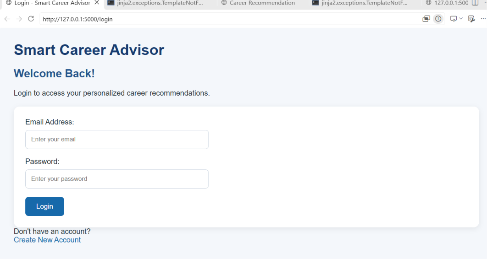
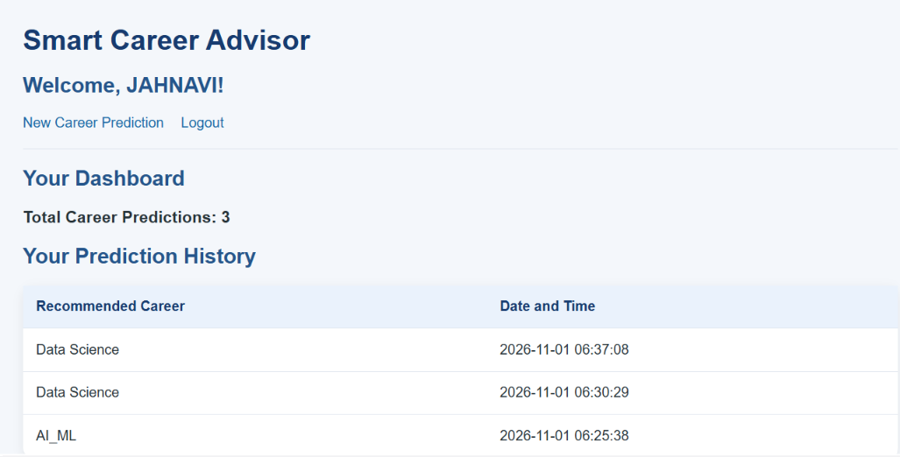
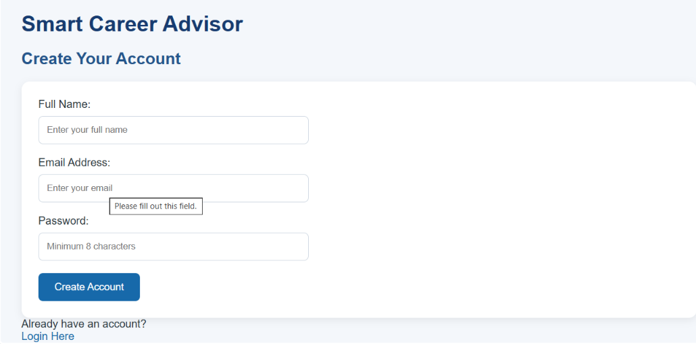
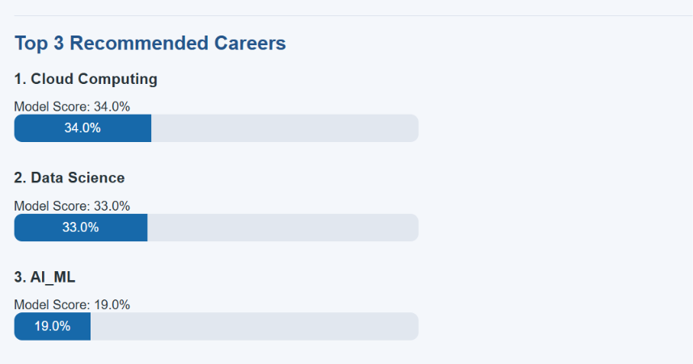
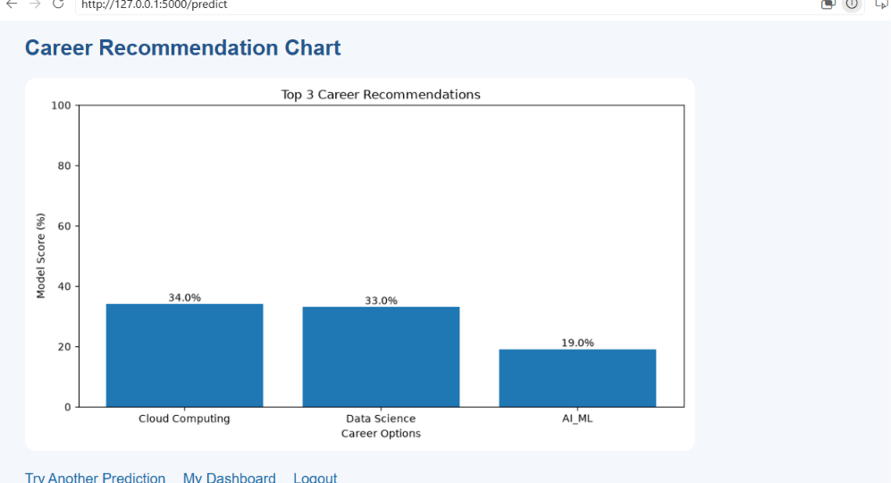

# Smart Career Advisor Using Machine Learning

## Project Overview

Smart Career Advisor is a machine learning-based web application that recommends suitable career paths based on a user's academic performance, technical skills, communication skills, problem-solving ability, projects, and certifications.

The application uses a Random Forest Classifier to generate the Top 3 career recommendations.

## Features

- User Registration and Login
- Secure Password Hashing
- Machine Learning-Based Career Prediction
- Top 3 Career Recommendations
- Prediction Scores and Visualization
- Interactive Career Prediction Dashboard
- User Prediction History
- SQLite Database Integration
- Responsive Web Interface

## Application Screenshots

### Home Page



### Login Page



### Registration Page



### Career Prediction Results



### Career Recommendation Chart



## Technologies Used

- **Frontend:** HTML, CSS
- **Backend:** Python, Flask
- **Machine Learning:** Scikit-learn, Random Forest, Pandas, NumPy, Joblib
- **Visualization:** Matplotlib
- **Database:** SQLite
- **Development Tools:** VS Code, Git, GitHub

## Career Categories

1. Data Science
2. Artificial Intelligence and Machine Learning
3. Web Development
4. Cyber Security
5. Cloud Computing

## Project Structure

```text
Smart-Career-Advisor-ML/
│
├── database/
│   ├── app.py
│   ├── db_setup.py
│   ├── career_dataset.csv
│   └── career_advisor.db
│
├── models/
│   └── career_model.joblib
│
├── static/
│   ├── style.css
│   └── career_chart.png
│
├── templates/
│   ├── index.html
│   ├── result.html
│   ├── login.html
│   ├── register.html
│   └── dashboard.html
│
├── screenshots/
│   ├── home.png
│   ├── login.png
│   ├── register.png
│   ├── prediction.png
│   └── chart.png
│
├── requirements.txt
└── README.md
```

## Installation and Setup

1. Clone the repository:

   `git clone https://github.com/jahnaviaretty/Smart-Career-Advisor-ML.git`

2. Navigate to the project folder:

   `cd Smart-Career-Advisor-ML`

3. Install the required packages:

   `python -m pip install -r requirements.txt`

4. Create the database:

   `python database/db_setup.py`

5. Run the application:

   `python database/app.py`

6. Open your browser and visit:

   `http://127.0.0.1:5000`

Register an account, log in, and explore your career recommendations.

## Machine Learning Workflow

1. Collect and prepare the career dataset.
2. Perform data preprocessing.
3. Train a Random Forest Classifier.
4. Evaluate the model.
5. Save the trained model using Joblib.
6. Load the model into the Flask application.
7. Generate Top 3 career recommendations.
8. Visualize recommendation scores using Matplotlib.

## Future Enhancements

- Improve the training dataset with more diverse records.
- Add more career categories.
- Improve model evaluation and recommendation quality.
- Add an administrator dashboard.
- Deploy the application online.
- Improve the user interface.

## Important Note

This is an academic demonstration project. The current model is trained on a small sample dataset. Its recommendation scores should not be interpreted as validated probabilities of career suitability.

## Author

**Aretty Jahnavi**

B.Tech – Computer Science and Engineering (Data Science)

GitHub: [jahnu08](https://github.com/jahnu08)
